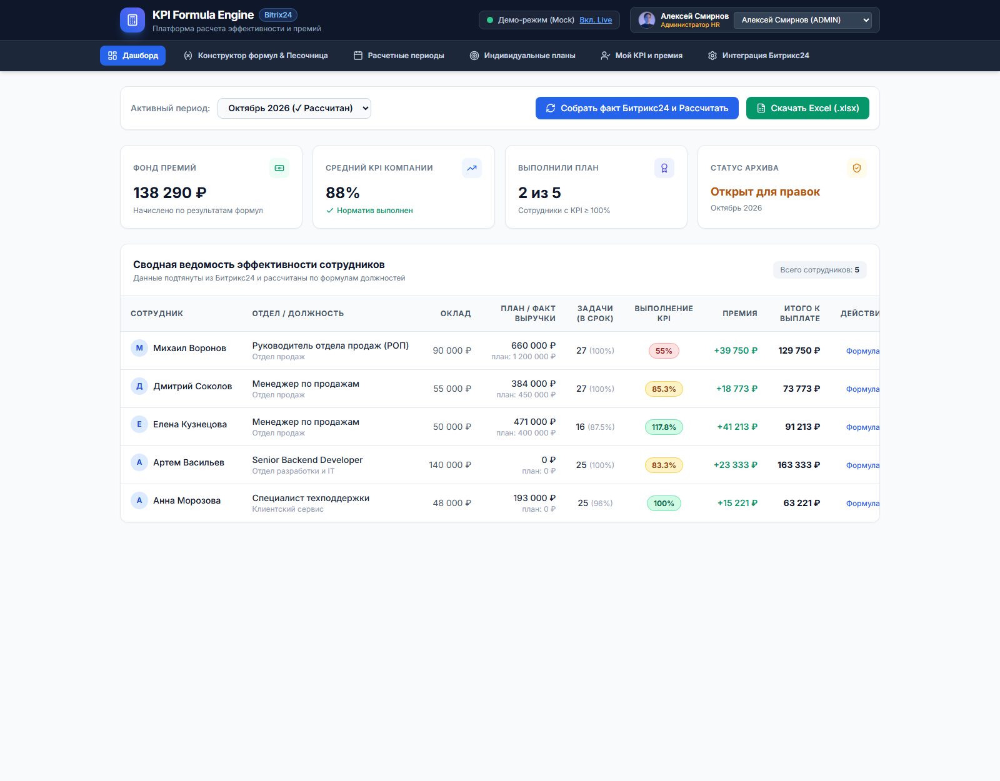
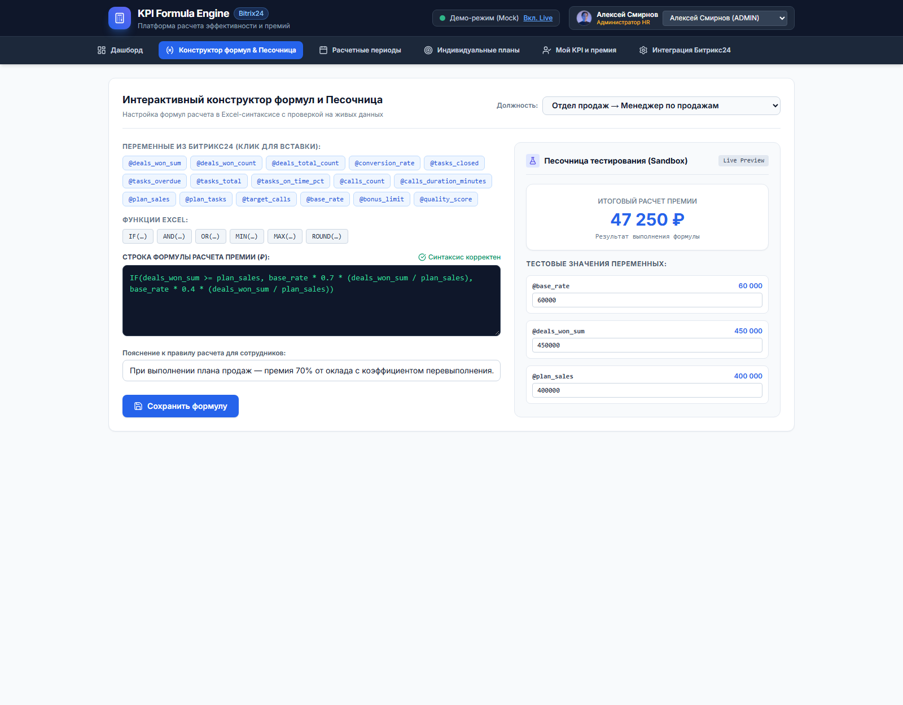

# Платформа расчета эффективности и KPI сотрудников (Formula Engine для Битрикс24)

Полнофункциональная веб-платформа для настройки гибких формул эффективности (KPI), расчета премий сотрудников на основе данных из **Битрикс24** (задачи, сделки CRM, телефония), периодической фиксации результатов и выгрузки детализированных ведомостей в **Excel (.xlsx)** и **CSV**.

---

## 📸 Интерфейс

**Дашборд**: сводные KPI компании, фонд премий и ведомость эффективности сотрудников.



**Конструктор формул с песочницей**: проверка формулы на тестовых значениях и мгновенный пересчет результата до сохранения.



---

## 🌟 Ключевые возможности

1. **Текстовый Excel-подобный редактор формул**:
   - Поддержка функций: `IF(условие, значение_если_истина, значение_если_ложь)`, `AND(...)`, `OR(...)`, `NOT(...)`, `MIN(...)`, `MAX(...)`, `ROUND(число, знаков)`, `ABS(...)`, `SUM(...)`, `AVG(...)`.
   - Операторы: `+`, `-`, `*`, `/`, `^` (степень), сравнения `>`, `<`, `>=`, `<=`, `==`, `!=`, проценты (`15%`).
   - Автоподстановка системных переменных из Битрикс24 (`deals_won_sum`, `@deals_won_sum`, `tasks_closed`, `tasks_on_time_pct`, `calls_count` и др.).
2. **Интерактивная песочница (Sandbox) с Live Preview**:
   - Мгновенная проверка синтаксиса, типов AST и неизвестных переменных в реальном времени.
   - Возможность менять тестовые значения переменных ползунками/полями и сразу видеть вычисленный результат в рублях до сохранения.
3. **Оргструктура и индивидуальные планы**:
   - Шаблоны формул привязываются к должностям (Менеджер ОП, РОП, Разработчик, Поддержка).
   - Индивидуальные плановые показатели (план продаж, план задач, оклад/базовая ставка) настраиваются персонально на каждый период.
4. **Периодический расчет и фиксация архива (Lock)**:
   - Запуск расчета за период в один клик с постраничным сбором фактов из Битрикс24.
   - Кнопка **«Зафиксировать период»** замораживает расчетные цифры навсегда (архив защищен от изменений задним числом).
5. **Экспорт в Excel (.xlsx) и CSV**:
   - Стилизованные ведомости со статусом периода, цветовой индикацией выполнения KPI, формулами и автоматической строкой `ИТОГО`.
6. **Ролевой доступ (RBAC) и переключатель Демо-режима**:
   - Полноценная серверная авторизация через bearer-токены сессий:
     - **Администратор (ADMIN)**: полный доступ к формулам, настройкам, расчету и закрытию периодов.
     - **Руководитель отдела (HEAD)**: управление планами и просмотр результатов сотрудников своего подразделения.
     - **Сотрудник (EMPLOYEE)**: просмотр только собственных результатов и начислений.
   - Встроенный **Mock-режим** с реалистичными данными для проведения автономной демонстрации без подключения живого портала.

---

## 🏗 Архитектура системы

Система построена по многослойной модульной архитектуре:

- **Презентационный слой (Frontend)**:
  - SPA на Vue.js 3 + Tailwind CSS без сборщиков (`app/static/index.html`, `app/static/app.js`).
  - Все библиотеки и шрифты лежат локально в `app/static/vendor` (Vue, Tailwind, Lucide, Inter, JetBrains Mono) — интерфейс полностью работает **без доступа в интернет**.
  - Интерактивный конструктор, реактивная песочница, ролевое скрытие элементов управления и авторизованный клиент `authFetch`.
- **Слой API (FastAPI Routers)**:
  - `app/api/auth.py`: авторизация, управление сессиями (`/login`, `/me`, `/logout`), переключение mock-режима.
  - `app/api/deps.py`: зависимости контроля доступа (`get_current_user`, `require_admin`, `require_head_or_admin`).
  - `app/api/periods.py`: управление периодами, запуск расчетов, фиксация архива, RBAC-фильтрация результатов.
  - `app/api/formulas.py`: шаблоны формул должностей, валидация и безопасная песочница.
  - `app/api/departments.py`: структура компании, сотрудники, установка индивидуальных планов.
  - `app/api/settings.py`: управление интеграцией с Битрикс24 и тестирование вебхука.
  - `app/api/export.py`: формирование файлов Excel (.xlsx) и CSV.
- **Сервисный слой (Core Services)**:
  - `app/services/formula_engine.py`: безопасный AST-парсер формул на Python с ограничением размера выражений, строгой валидацией констант и переменных каталога, запретом вызовов опасных методов и встроенных функций.
  - `app/services/calculation_service.py`: транзакционный движок расчета KPI, начисления премий и фиксации периодов.
  - `app/services/bitrix_service.py`: асинхронный клиент Битрикс24 REST API с поддержкой постраничной пагинации (`start`/`next`), валидацией ответов и генератором правдоподобных mock-данных.
  - `app/services/settings_service.py`: хранение конфигурации платформы и маскирование секретов.
- **Слой данных (Persistence)**:
  - SQLAlchemy 2.0 ORM, SQLite с принудительным включением внешних ключей (`PRAGMA foreign_keys = ON`), каскадными связями и автосидированием демонстрационной базы данных.

---

## ⚠️ Известные ограничения

1. **Демо-аутентификация и эндпоинт пользователей**: Список пользователей (`GET /api/auth/users`) доступен без авторизации — оставлен открытым исключительно для демонстрационного стенда (быстрое переключение ролей в UI). Вход в демонстрационном стенде выполняется выбором пользователя из списка без ввода пароля (генерируется защищенный токен сессии на сервере). Для production-развертывания требуется подключение SSO/OAuth2 или корпоративного каталога LDAP.
2. **База данных по умолчанию**: По умолчанию используется встраиваемая SQLite-база (`kpi.db`). Архитектура полностью готова к подключению PostgreSQL через переменную окружения `DATABASE_URL`.
3. **Источники данных телефонии**: При работе с живым Битрикс24 без настроенной телефонии VoxImplant показатели звонков не фальсифицируются и принимаются равными `0` (в сырых метриках фиксируется статус недоступности источника).
4. **Резервный режим Битрикс24**: При сетевой недоступности портала Битрикс24 или ошибках авторизации сервис прозрачно переходит на резервные демо-данные с явным предупреждением в расчете.
5. **Смысл показателя «KPI, %»**: Показатель `KPI, %` в карточках сотрудников, таблице результатов и выгрузках отражает выполнение индивидуального плана продаж (`fact_sales / plan_sales * 100`), а при его отсутствии (`plan_sales == 0`) — выполнение плана задач (`fact_tasks / plan_tasks * 100`). Это **не** процент от формулы премии: сумма премии рассчитывается отдельно по гибкой формуле должности (которая может учитывать оклады, пороги, проценты от выручки и надбавки).

---

## 🚀 Быстрый запуск

Платформа клиент-серверная: просто открыть `app/static/index.html` недостаточно — нужен запущенный Python-бэкенд.

**Windows — в один клик:** двойной щелчок по `start.bat` (поставит зависимости, поднимет сервер и откроет браузер).

**Вручную (любая ОС):**
```bash
pip install -r requirements.txt
python run.py
```
Затем откройте в браузере:
- **Веб-интерфейс**: [http://127.0.0.1:8000](http://127.0.0.1:8000)
- **Интерактивная документация API (Swagger)**: [http://127.0.0.1:8000/docs](http://127.0.0.1:8000/docs)

> В демонстрационном режиме (включен по умолчанию) при первом запуске последний период рассчитывается автоматически, поэтому дашборд сразу заполнен данными. Подключение живого портала — на вкладке «Интеграция Битрикс24».
>
> ⚠️ Если страница открыта без запущенного сервера, сверху появится красное предупреждение «Нет связи с сервером приложения»: данные и кнопки в этом режиме не работают.

---

## 🌐 Демонстрация в интернете

GitHub Pages для этого проекта **не подходит** — нужен работающий Python-бэкенд, а Pages раздаёт только статические файлы. Способы опубликовать живое демо:

1. **Render (бесплатный тариф)** — в репозитории уже лежат `render.yaml` и `Dockerfile`:
   1. Зарегистрируйтесь на [render.com](https://render.com) через GitHub.
   2. *New* → *Blueprint* → выберите репозиторий `kpi-platform` (Render прочитает `render.yaml` сам).
   3. После сборки получите публичный адрес вида `https://kpi-platform.onrender.com`.
2. **Docker-хостинг** (Fly.io, Railway, VPS):
   ```bash
   docker build -t kpi-platform .
   docker run -p 8000:8000 kpi-platform
   ```
3. **Локальный запуск** — самый быстрый способ показать проект на встрече или на созвоне через демонстрацию экрана.

---

## 🧪 Запуск автоматических тестов
В проекте реализованы тесты ядра формул, синтаксиса Excel, защищенности AST, ролевого доступа RBAC, внешних ключей БД, пагинации Битрикс24 и настроек:
```bash
python -m pytest tests/ -v
```

---

## 📋 Сценарий демонстрации заказчику

1. **Вход и Дашборд**:
   - Откройте `http://localhost:8000`. В правом верхнем углу виден статус «Демо-режим (Mock)».
   - На Дашборде отображаются сводные KPI: общий фонд премий, средний процент выполнения по компании, количество сотрудников, выполнивших план, и таблица лидеров.
2. **Конструктор формул**:
   - Перейдите на вкладку **«Конструктор формул & Песочница»**.
   - Выберите должность (например, *«Менеджер по продажам»*).
   - Измените формулу или кликните по переменным/функциям (например, добавьте условие перевыполнения плана).
   - В правой колонке (Песочница) измените тестовую выручку или оклад — результат обновится мгновенно в реальном времени!
   - Нажмите **«Сохранить формулу»**.
3. **Периоды и Расчет**:
   - Перейдите на вкладку **«Расчетные периоды»**.
   - Нажмите **«Рассчитать»** у нужного месяца — система соберет факт сделок/задач и применит формулу к каждому сотруднику.
   - Нажмите **«Зафиксировать»** — период перейдет в статус архивного и защитится от изменений.
   - Нажмите **«Excel (.xlsx)»** — откроется скачанная ведомость с итоговыми суммами и формулами.
4. **Личный кабинет сотрудника**:
   - В верхнем правом углу переключите пользователя на сотрудника (*«Дмитрий Соколов»*).
   - Откроется вкладка **«Мой KPI и премия»** с прозрачной карточкой: личный оклад, факт из Битрикс24, примененная формула и начисленная премия.
